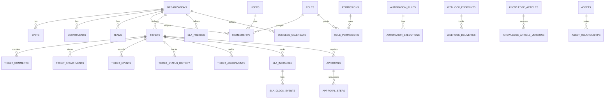

# Modelo Entidade-Relacionamento (ERD) — Civora

## Principais Índices Projetados

- `tickets(tenant_id, status, created_at DESC)`: listagem principal paginada e filtros por aba.
- `tickets(tenant_id, priority, status)`: cards críticos e triagem prioritária.
- `tickets(tenant_id, assigned_team_id, status)` e `tickets(tenant_id, assignee_id, status)`: filas de equipe e agente.
- `tickets(tenant_id, unit_id, status)` e `tickets(tenant_id, due_at)`: seletor de unidade e vencimentos de SLA.
- `knowledge_articles_fts_idx` (`GIN to_tsvector('portuguese', ...)`): busca full-text na base de conhecimento.
- `outbox_events(status, next_attempt_at)`: polling eficiente do relay transacional sem varredura completa.

