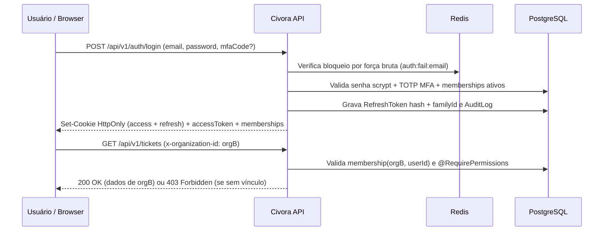
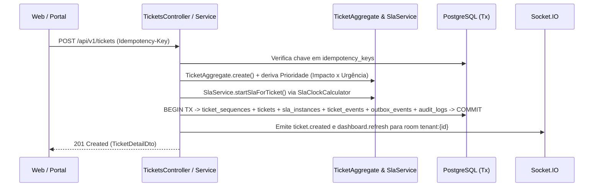

# Fluxos Operacionais Principais

## 1. Fluxo de Autenticação, Rotação de Refresh Token e Multi-Tenancy

## 2. Fluxo de Criação de Chamado (Vertical Slice Completo)

## 3. Fluxo do Relógio de SLA

1. Ao criar o chamado, a política mais específica (`service > category > department > unit > padrão`) calcula `firstResponseDueAt` e `resolutionDueAt` somando minutos úteis apenas nos turnos do calendário comercial e ignorando feriados.
2. Quando o chamado transiciona para `WAITING_CUSTOMER`, `WAITING_THIRD_PARTY` ou `WAITING_APPROVAL`, o relógio entra em `PAUSED` e registra `SlaPaused`.
3. Ao retomar para atendimento ativo, os minutos úteis transcorridos durante a pausa são adicionados às datas de vencimento e registra-se `SlaResumed`.
4. O `apps/worker` executa `processSlaEvaluationTick` periodicamente: ao atingir `warningThresholdPct`, altera para `WARNING` e emite `SlaWarningReached`; ao ultrapassar `resolutionDueAt`, altera para `BREACHED` e emite `SlaBreached`.

## 4. Fluxo das Automações & Proteção contra Loops

1. Eventos em `outbox_events` são publicados pelo worker na fila `civora-automations`.
2. O consumidor verifica `checkAutomationLoopProtection` (`depth < 5` e regra ainda não executada na cadeia `correlationId`) e checa `automation_executions.idempotency_key`.
3. Avalia todas as condições (`eq`, `neq`, `contains`, `in`, `gt`, `lt`, `is_empty`, `not_empty`) e aplica as ações configuradas.
4. Falhas repetidas executam backoff exponencial e são encaminhadas para `civora-dead-letter`.

